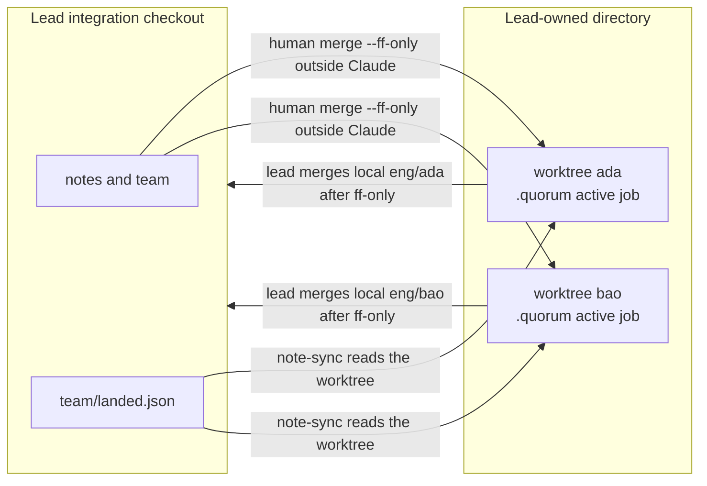
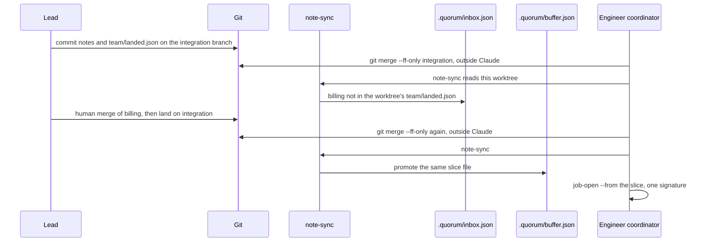
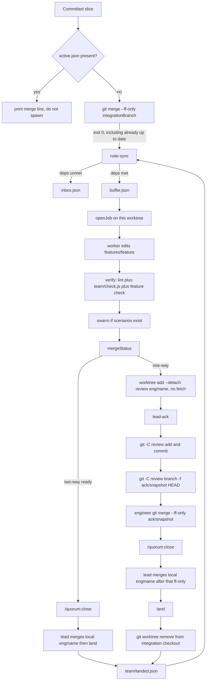

# Quorum for a small team: intent to human merge

| Field | Value |
| --- | --- |
| Author | Quorum design |
| Date | 2026-10-21 |
| Status | Draft |
| Plugin | `quorum` 0.1.0 today; this design's first PR bumps it to 0.2.0. Claude Code, Node >= 20, ESM |
| Audience | Engineers changing `scripts/quorum.js`, agents, commands, and `scripts/quorum.spec.js` |

## Overview

Quorum today is a one-checkout factory. `openJob` in `scripts/quorum.js` throws while `.quorum/active.json` exists, the coordinator takes the first alphabetical confirmed signature and stops, and a human runs `/quorum:close` then merges. That is the right inner loop for one engineer. It is the wrong shared kitchen for two people: a second Claude process in the same working tree shares `active.json`, the trace, the feature fence, and the gitignored inbox.

This design keeps that inner loop and gives a team of 2 to 8 engineers, plus one lead, a way to run it at the same time on one product repo. The lead commits a product note, splits it on feature boundaries into frozen slice files, owns `team/check.js`, claims one signature per engineer, and is the only person who merges. Each engineer is one `quorum:coordinator` on their own git worktree, with their own `.quorum/`. An intent whose `depends_on` features are not in the worktree's `team/landed.json` stays in the inbox. When no job is active, the engineer gets that file by `git merge --ff-only` of the integration branch outside Claude, not by `git fetch`. An already up to date exit still allows `note-sync`. An open `active.json` skips that fast-forward. `note-sync` then promotes the next slice from the file. Nobody retypes the snapshot, and nobody refreshes it mid-job.

The plugin still does not merge, push, subscribe to Slack, Linear, X, or email, or mark a shortcut resolved. `trust.json` keeps `merge: "human"`. Playwright stays one verifier's 1 to 10 browser contexts.

## Background & Motivation

The current runtime matches a single pilot, not a brigade.

- State lives only under the target `.quorum/`, which `.gitignore` ignores. `quorumDir` creates it on write. Idle `quorumStatus` and the Stop hook do not create it. The model cannot edit `.quorum/` (`preToolDecision` denies that path).
- `fileReport` writes `inbox.json` when `confirmed` is false and `buffer.json` when it is true. Optional `feature` and `door` are stored by `placedRow`. `intakeFile` accepts a JSON array and passes only `summary`, `signature`, `source`, `confirmed`, `feature`, and `door`. There is no `depends_on`.
- `assign` groups buffer rows by `signature`. The coordinator in `agents/coordinator.md` sorts those signatures alphabetically, spawns one `quorum:worker`, then one `quorum:verifier`, and stops. Same signature is already one job. One agent per bug is already refused by that text.
- `openJob` stores `{ id, feature, door, intent, check }` in `.quorum/jobs/<id>.json` and `.quorum/active.json`, and writes `.quorum/snapshots/<id>.md`. The id is an 8-hex random value, not a stable product id. Nothing stops a second checkout from opening the same signature, because the second checkout cannot see the first checkout's gitignored state.
- `runVerify` lints `features/**/*.{js,mjs}` (80-line cap from `.quorum/lint.json`, cross-feature import ban) and runs the snapshot command with a default 300s timeout. Every `verify` calls `writeLineCap` with the cap it used, including the default 80, so `.quorum/lint.json` is rewritten on each run. `isNoopCheck` refuses a command that is `process.exit(0)`, or that matches `true`, `false`, `:`, or `exit 0`. A clean lint with no check stays red. While the job is active, `preToolDecision` freezes paths named by `checkPaths`. With no `active.json`, `runVerify` sets the check to `""`, `runCheck` returns `exitCode: null`, and `passed` is false.
- `mergeStatus` never git-merges. A one-way door with an empty check is refused. If `features/<feature>/swarm/*.js` exists, a fresh passing `.quorum/traces/swarm.json` is required. `closeJob` deletes `active.json` only when `mergeStatus` is ready, and leaves the job record and the trace. It does not remove buffer rows today.
- `shellDecision` always denies `BLOCKED_SHELL` (`git merge` except `git merge-base`, `git push`, `git rebase`, `gh pr merge`) and any command whose text includes `.quorum`, whether or not a job is active. The `.quorum` bash deny runs before `active.json` is read. Only when `active.json` exists does it also deny `SHELL_JOIN`, `SHELL_EVAL`, redirects, and writers outside `features/<feature>/`. `scripts/quorum.spec.js` already expects `git merge-base HEAD main` to be allowed. This is a command fence, not a sandbox. Idle sessions must keep the always-on `.quorum` bash deny. The README sentence that limits that deny to an active job is behind the code. Do not "fix" the code to match that sentence.
- `recordFailure` writes `.quorum/proposed/<slug>.md` on the second identical signature and sets `.quorum/trust.json` to `{ rung: "sampling", merge: "human" }`. There is no resolve API. `addSample` does not raise trust.
- Agents set `omitClaudeMd: true`. The coordinator has no Bash, Write, or Edit, `maxTurns` 12. The worker has `maxTurns` 20 and may `check-init` before `job-open`. The verifier does not edit and tells the human to `/quorum:close`. The scanner appends rows and does not fix. Hooks are SessionStart, PreToolUse, Stop, SubagentStop, and PostToolUse (`hooks/hooks.json`). `examples/target/.claude/settings.json` allows only `Bash(node features/*/check.js)` and `Bash(node *quorum.js *)`.

The pain is structural. Two engineers who share a checkout clobber one `active.json`. A dependency between features is invisible, so a slice can be confirmed before the feature it needs has merged. The intent the worker sees is whatever string the session was given, so the lead still ferries a live PRD. Verification is per feature command, not a team check the lead owns. One-way work becomes "ready for human merge" as soon as the check is non-empty and green, with no stop that forces the lead to look.

The method is the one filed from Lauren Tan's 2026-10-02 stream with Matt Pocock: the lead builds the kitchen, engineers cook one frozen snapshot each, verification is team infrastructure, and merge stays human. Research notes live in `research_notes/Michelin kitchen harness plan/`. This design does not invent a Dune tree, an Electron app, a context graph, or a vendored pstack.

## Goals & Non-Goals

### Goals

- Let 2 to 8 engineers each run one coordinator, one active job, on one product repo, without sharing a working tree.
- Keep that repo as one shared clone: the lead's checkout, the engineer worktrees, and the one-way review worktree. They share one object store. Neither the one-way handoff nor the two-way handoff requires `git fetch` or `git push`. A remote, if one exists, is outside both handoffs.
- Represent a product note as committed slice files with front matter `id`, `signature`, `feature`, `door`, `depends_on`, and `check`.
- Keep an unmet `depends_on` in the inbox. Promote it with `note-sync` after the dependency is recorded in `team/landed.json`, without retyping the snapshot.
- Keep the inner loop: frozen snapshot, edits only under `features/<feature>/`, shared check plus that feature's cases, human `/quorum:close`, human merge by the lead.
- Make one-way doors stop for the lead even when the feature check is green, once the team kitchen file exists.
- Leave deterministic decisions in `scripts/quorum.js` and workflow in markdown skills.
- Ship as a sequence of reviewable plugin pull requests. Absence of `team/kitchen.json` keeps the team guards off: no worktree check, no claim check, no one-way lead stop, and a noop `openJob` still opens. One behavior still changes without that file. On a successful `mergeStatus`, `closeJob` sets `closed: true` and deletes matching inbox and buffer rows. It deletes by signature only when the job's signature is a non-empty string, and by `snapshot` only when both strings are non-empty and equal. An empty `snapshot` does not match a row that lacks the field. Abandon stays a manual delete of `active.json` with `closed` left unset.

### Non-goals

- Self-merge, `gh pr merge`, overnight merge, or any change to `trust.merge`. It stays `human`.
- A live outer loop. No Slack, Linear, X, email, or other subscription that starts a session. No Grok Bot watcher. No context graph.
- Ten LLM verifiers, a CDP verifier, or a swarm of coding agents. `scripts/playwright_swarm.js` stays 1 to 10 sequential isolated Chromium contexts inside one verifier.
- Editing outside `features/<feature>/` during a job. That fence stays.
- A multi-job lock, a second `active.json`, or two coordinators in one working tree.
- A second clone. This version does not publish `ack/<snapshot>` to a remote, does not have the engineer fetch `ack/<snapshot>:ack/<snapshot>`, and does not have the lead fetch `eng/<name>` before detach or before merge. Engineers work in worktrees of the lead's clone.
- The model marking a failure resolved, applying a proposed lint, or rewriting a snapshot mid-job.
- Deploy, production watch, rollback automation, or a command that launches `claude`.
- Vendoring pstack, copying a Dune file tree, or adding a runtime dependency beyond `playwright`.
- Thousands of concurrent jobs. The load target is dozens of feature directories and at most one active job per engineer.
- One branch per signature. The branch is `eng/<name>`, one long-lived branch per engineer. A signature branch would only multiply worktrees. The engineer fast-forwards onto the integration branch between jobs.
- A claims line on `quorum status`. The lead reads `team/claims.json`. Status stays the job, buffer, and trace lines.
- Remote branch protection, forge policy, and any call to `gh`. The plugin does not configure them. The lead's merge stays a git command a human types.
- A tautology prover beyond today's noop list. `assert.ok(true)` stays undetected. The lead samples.

## Proposed Design

### Roles

The lead owns intent, feature boundaries, the shared check, claims, sampling, and the integration merge. The lead does not paste a live PRD into engineer sessions. Engineers do not merge to the integration branch and do not edit `notes/` or `team/`.

| Role | Session | Writes | Does not |
| --- | --- | --- | --- |
| Lead | Editor or a normal shell on the integration checkout. Not `quorum:coordinator` for authoring. | `notes/`, `team/check.js`, `team/kitchen.json`, `team/claims.json`, `team/landed.json`, `team/acks/` | Run the worker. Merge from inside Claude. |
| Engineer | `claude --plugin-dir <harness> --agent quorum:coordinator` from their worktree | `features/<feature>/` after the job is open, via the worker | Confirm someone else's signature, edit `.quorum/`, edit `notes/` or `team/`, push, merge |
| Coordinator | Main thread only | Nothing. Tools stay `Agent(quorum:worker, quorum:verifier, quorum:scanner), Read, Grep, Glob` | Bash, Write, Edit, a second signature, `job-close` |
| Worker | One subagent, `maxTurns` 20 | `features/<feature>/` only | Refresh the snapshot, open a second job, merge |
| Verifier | One subagent, `maxTurns` 4 | Traces, by running `quorum.js` | Edit, close, merge |
| Scanner | Optional, `maxTurns` 4 | Inbox or buffer rows | Fix, open a job, watch a channel |

`omitClaudeMd: true` stays on all four agents. Project `CLAUDE.md` still does not steer them. Conventions that must hold during a job belong in the slice body and in the check.

### Artifact layout

Two stores, on purpose. Gitignored `.quorum/` is one checkout's session. Committed `notes/` and `team/` are the kitchen, but only in the working tree that contains those commits. `git fetch` updates remote-tracking refs. It does not change `notes/`, `team/landed.json`, `team/claims.json`, `team/acks/`, or slice files on a worktree whose branch is `eng/<name>`. `note-sync` reads that worktree, not the remote. Putting the queue only in `.quorum/` would make a dependency invisible to the next engineer.

```text
<product-repo>/                      # integration checkout, lead's primary worktree
  .gitignore                         # already ignores .quorum/
  notes/
    <note-id>.md                     # lead's index. Not worker intent.
    <note-id>/
      <feature>.md                   # one frozen slice. One signature. One feature.
  team/
    kitchen.json                     # opts into team mode. Missing => today's behavior.
    check.js                         # lead-owned shared verification command
    claims.json                      # signature -> engineer
    landed.json                      # features the lead has merged
    acks/<snapshot-id>.json          # one-way lead acknowledgement
    failures.jsonl                   # shortcut lines from every checkout
    proposed/<slug>.md               # copy of a proposal the lead can commit
  features/
    <feature>/
      feature.js
      check.js                       # feature cases, frozen after job-open
      VERIFY.md
      swarm/*.js                     # optional, this feature's verifier only
      public/index.html              # optional, swarm static page
  .quorum/                           # gitignored, this checkout only
    active.json
    engineer.json                    # worktrees only: { "name": "ada" }
    inbox.json
    buffer.json
    buffer.md
    jobs/<job-id>.json
    snapshots/<job-id>.md
    traces/latest.json
    traces/swarm.json
    trust.json
    lint.json
    failures.json
    proposed/<slug>.md

<lead-dir>/                          # outside the repo, named by team/kitchen.json
  <engineer>/                        # git worktree, own .quorum, own branch
```

`team/kitchen.json` (committed, version 1):

```json
{
  "version": 1,
  "integrationBranch": "main",
  "treesDir": "../quorum-trees"
}
```

`treesDir` is relative to the product repo root. `tree-add` resolves it and refuses the command unless the absolute path is outside the primary worktree. Eight engineer directories under that parent is the capacity. The plugin does not create a worktree inside the repo and does not start Claude.

Example for engineer `ada`, feature `invoice`, snapshot `2026-10-21-invoice-cents`:

```text
../quorum-trees/ada/                 # git worktree
  .git                               # gitdir file, not a second clone's object store
  .quorum/engineer.json              # { "name": "ada" }
  notes/2026-10-21-invoice/invoice.md
  features/invoice/check.js
```

Branch name, created by `tree-add`, is `eng/<name>` from `integrationBranch`. This is one long-lived branch per engineer, not one branch per signature and not one branch per sentence. One active job is the cap, so a signature branch would only multiply worktrees. The branch holds that job's commits until the lead merges local `eng/<name>`. Between jobs, when `active.json` is absent, the engineer fast-forwards onto the integration branch. That fast-forward is the start-of-slice step below. It is not optional and it is not an open question.

Bringing the integration branch into that worktree is a human git command outside Claude. `note-sync` does not fetch and does not merge. The integration fast-forward is how a new slice starts. It is not how an open job finishes.

- If `.quorum/active.json` exists, skip `git merge --ff-only <integrationBranch>`. The coordinator does not spawn. The human finishes from the merge-status line. Unique commits on `eng/<name>` are the open job, including a one-way job that is waiting for `ack/<snapshot>`. The ack ref is not the integration branch. Fast-forwarding integration in that session stops the ack path, so this design does not do it.
- If `active.json` is absent and the engineer is starting a slice, run `git merge --ff-only <integrationBranch>` from the engineer worktree when the worktree is missing new kitchen commits. Exit 0 allows `note-sync`, including Git's "Already up to date." That exit has not changed the worktree, and `note-sync` still runs. A fast-forward that does move the branch updates `notes/` and `team/` in the working tree.
- If `--ff-only` fails because `eng/<name>` has unique commits and there is no active job, the human stops and does not `note-sync`. Those commits were abandoned or were never closed. They do not rebase, and they do not run the merge inside Claude (`git merge` stays denied by `BLOCKED_SHELL`). A non-fast-forward `git merge <integrationBranch>` is also outside the plugin. This design does not add a command for it, because that command would be a merge.

The plugin does not run `git merge`, `git pull`, or `git rebase`. Fetch alone is not a step in the engineer loop.

### Product note and slice front matter

The index `notes/<note-id>.md` is the lead's map of feature boundaries. The worker never reads it. The coordinator never joins its paragraphs into intent. A design doc that every engineer re-reads is not the design stage. The feature directory, the lint, and `team/check.js` are the architecture. The slice file is the frozen plan for one feature.

`notes/<note-id>/<feature>.md`:

```markdown
---
id: 2026-10-21-invoice-cents
signature: invoice-cents
feature: invoice
door: two-way
depends_on: ["billing"]
check: "node features/invoice/check.js"
---

Cents on the invoice total survive rounding.
The check fails while the total drops cents.
```

Front-matter subset, parsed in `scripts/quorum.js` with no YAML dependency:

| Field | Required | Rule |
| --- | --- | --- |
| `id` | yes | Snapshot id. `^[a-z0-9][a-z0-9-]{0,63}$`. Stable across checkouts. Not the random job id. |
| `signature` | yes | `^[a-z0-9-]+$`. One signature is one job. Two slices with the same signature fail `note-check`. |
| `feature` | yes | `^[a-z0-9-]+$`. Directory `features/<feature>/`. One signature maps to one feature. The tree has at most one `notes/**/<feature>.md` for that feature. |
| `door` | yes | `two-way` or `one-way`. |
| `depends_on` | yes | One-line JSON array of feature slugs. `[]` if none. Not snapshot ids. Self is illegal. |
| `check` | yes | JSON string, exactly `node features/<feature>/check.js`. |

`note-check` also rejects a `depends_on` cycle across the slice set, a `check` that `isNoopCheck` or `BLOCKED_SHELL` would refuse (`isNoopCheck` includes `false`, not only `true`), and a signature whose `slug()` is not the signature itself. The body after the closing `---` is the intent, copied verbatim at `job-open`. A changed product replaces the one slice file for that feature with a new `id`. The lead deletes every other `notes/**/<feature>.md` in that same integration commit. Editing the body of a snapshot that already has an active job does not refresh `.quorum/snapshots/<job-id>.md`.

`note-check` counts paths, not the ledger. For each feature, more than one `notes/**/<feature>.md` fails `note-check`, whether or not one of those ids is `team/landed.json`'s current snapshot. A missing ledger does not make a second path legal. `claim` uses the same count and refuses the claim. It does not pick a leftover predecessor and treat it as the open slice. The ledger stores only the latest snapshot, so it cannot tell a predecessor file from new work. Two engineers therefore cannot both be assigned `features/invoice/`. Publishing the next snapshot is replacing the single remaining file. `land` records the `id` that file names. A later snapshot does not re-block dependents. A rebuild that dependents must wait for is a new feature directory, not a second path for the same directory.

`depends_on` names features, not snapshot ids. The first time `billing` appears in `team/landed.json`, slices that list `billing` can leave the inbox. Replacing `notes/**/billing.md` after that land is the next job in the same directory. It does not re-block dependents.

### Worktrees, not a multi-job lock



`git fetch` on the engineer worktree is not an edge in this diagram. After the lead commits on the integration branch, the engineer worktree still has the old `notes/` and `team/` until the human fast-forwards. That edge runs only when `active.json` is absent and the engineer is starting a slice. An open job skips it. An exit 0 that is already up to date still allows `note-sync`. The return edge is the lead merging local `eng/<name>` only after the engineer's `git merge --ff-only ack/<snapshot>` has moved that ref. There is no fetch and no second push. A second clone is not a path in this diagram.

`git worktree add` shares the object database and not the working tree. `.quorum/` is untracked, so each worktree gets its own inbox, buffer, `active.json`, and traces. That is the clobber fix. A lock file inside one tree would still share the fence and the feature files.

`openJob` does not grow a second active slot. The existing throw stays: a second `openJob` in the same root throws, naming `job-close` or deleting `.quorum/active.json` outside the session.

New guard, only when `team/kitchen.json` exists:

- Resolve the root with `git rev-parse --show-toplevel` and whether this path is the primary worktree (`.git` is a directory, or `git rev-parse --git-dir` and `--git-common-dir` name the same place). If it is primary, `openJob` throws `integration checkout is the lead's. Open the job on an engineer worktree.`
- Read `.quorum/engineer.json`. `tree-add` writes it. If the file is missing, `openJob` throws `engineer name is missing`.
- Read `team/claims.json`. The signature must be claimed by that engineer. Unclaimed, or claimed by someone else, throws. No claims file in team mode throws `lead has not claimed this signature`, rather than falling through to "whoever opens first".

`tree-add --engineer <name>` (lead terminal):

1. Refuse unless `team/kitchen.json` is valid and `treesDir` resolves outside the primary worktree.
2. Refuse if `<treesDir>/<name>` exists, or if the engineer name is not `^[a-z0-9-]+$`.
3. If branch `eng/<name>` is already checked out in any worktree, refuse. `git worktree add` cannot check that branch out twice. Do not use `--force`.
4. If `eng/<name>` does not exist, run `git worktree add -b eng/<name> <abs> <integrationBranch>` from the primary checkout.
5. If `eng/<name>` exists and is not checked out, run `git worktree add <abs> eng/<name>` with no `-b`. That reattaches the worktree `tree-remove` left behind. Do not delete the branch by default, and do not add a `--replace-branch` flag.
6. Write `<abs>/.quorum/engineer.json` as `{ "name": "<name>" }` only when that file is absent, so a reattach does not wipe a name. Write nothing else. Do not copy another tree's `.quorum`. Do not start Claude.

`tree-list` prints `git worktree list --porcelain` filtered to `treesDir`. `tree-remove --engineer <name>` runs `git worktree remove` only when that worktree has no `active.json`. It does not delete `eng/<name>` and it does not merge. The next `tree-add` for that name takes step 5.

Two coordinators in one worktree still share `active.json`. The command does not try to detect a second Claude process. The team rule is one session per worktree.

Without `team/kitchen.json`, none of these guards run. `examples/target` and the current unit tests keep opening a job in a temp directory that is not a git checkout.

### How a dependency blocks and then unblocks



The second `--ff-only` is how the next slice starts, after the previous job is closed and `active.json` is gone. If it fails because `eng/<name>` still has unique commits, `note-sync` is not run against a stale tree and the slice stays where the previous sync left it. The engineer does not get the land by fetching. While `active.json` exists, this fast-forward is skipped. "Already up to date" is exit 0 and still runs `note-sync`.

`readLanded(root)` reads `team/landed.json`. A missing file means no feature has landed. Shape:

```json
{
  "version": 1,
  "features": {
    "billing": {
      "snapshot": "2026-10-21-billing",
      "signature": "billing-total",
      "commit": "<40-hex>",
      "landedAt": "2026-10-21"
    }
  }
}
```

`unmetDeps(root, dependsOn)` returns every slug not present as a key in `features`. Comparison is exact. There is no wildcard.

`note-sync` is the only promoter of slice rows. `fileReport`, `buffer-add`, `intake`, and the scanner do not write `depends_on`, `snapshot`, or `note`. If those fields are passed, `fileReport` throws `slice rows are filed by note-sync` and writes nothing. A scanner smell stays a signature row with no dependency. It is not a second copy of a slice, and it is not how a dependency unblocks. There is no later pass that promotes a hand-filed inbox row.

`summary` on a slice row is the first non-empty body line, truncated at 200 characters. The full body is not stored in the row. `job-open --from` reads the file again for `intent`.

`note-sync` is idempotent:

1. Run the same checks as `note-check`. Invalid slices are listed on stderr and skipped. They are not filed. Two `notes/**/<feature>.md` paths fail this step for that feature.
2. If the slice `id` is the landed snapshot for its feature, or this checkout has a job file with that `snapshot` and `closed: true`, delete every inbox row and every buffer row with that `snapshot`. Do not append. A landed or closed slice is consumed. This is not `status: "resolved"` and it is not a failure-resolve API. A row with no `snapshot` is not deleted here.
3. Before any inbox upsert or buffer append for this slice: if a buffer row has this signature and its `snapshot` is missing or `""`, and no buffer row has this slice's `snapshot`, do not append, do not upsert an inbox row, and do not delete that old row. Print `skipped <signature>: buffer row has no snapshot`. Skip steps 4 through 6 for this slice. The human deletes that row outside the session. A row with no `snapshot` does not count as "a buffer row has that `snapshot`".
4. If any `depends_on` entry is unmet, upsert one inbox row keyed by `snapshot`. Set `confirmed: false`, `blocked` to the unmet slugs, `source` to `note`, and `summary` to the truncated first body line. Remove any buffer row with that `snapshot` so a land that was reverted cannot leave the slice confirmed.
5. If every dependency is landed, the snapshot is not consumed under step 2, step 3 did not skip, and no buffer row has that `snapshot`, delete every inbox row with that `snapshot` and append one buffer row.
6. If a buffer row already has that `snapshot`, leave it and still delete inbox rows with that `snapshot`. Do not append a second row.
7. If the slice file disappeared, the snapshot is not the active job's `snapshot`, drop local inbox and buffer rows for that `snapshot`. If it is the active job, leave `.quorum/snapshots/<job-id>.md` and the buffer row alone. Do not drop a signature-only row here.
8. Do not create `.quorum/` when there are zero slice files and no existing `.quorum`. Same rule as idle status: a read of nothing does not mkdir. A real promotion may write `.quorum`, because it is not the Stop hook.
9. Rows that have no `snapshot` (scanner and `buffer-add`) are not deleted and not rewritten, except that step 3 refuses to add a second row beside them.

The human does not retype intent. `job-open --from notes/<note-id>/<feature>.md` reads the slice, checks that `--feature` is absent or equal, and copies the body into the job's `intent` and into `.quorum/snapshots/<job-id>.md`. The snapshot file gains the stable id:

```markdown
---
id: <job-id>
snapshot: 2026-10-21-invoice-cents
signature: invoice-cents
feature: invoice
door: two-way
depends_on: ["billing"]
check: "node features/invoice/check.js"
note: notes/2026-10-21-invoice/invoice.md
---

Cents on the invoice total survive rounding.
```

`job-id` stays the random 8-hex id from `randomUUID`. `snapshot` is the stable id. Local job files stay gitignored. The committed slice is what the next checkout syncs.

`/quorum:sync` runs only `note-sync`. The coordinator has no Bash, so the engineer runs sync before the prompt `Work the confirmed buffer.`, or from the slash command in a session that is allowed `Bash(node *quorum.js *)`. The coordinator does not confirm inbox rows by hand. A slice row appears in `buffer.json` only because `note-sync` put it there. `fileReport` still files smells that have no `depends_on`.

### Inner loop

Per engineer, per claimed signature. Two-way and one-way share steps 3 through 5 only while `active.json` is absent. They do not share the finish order. Two-way is `/quorum:close`, then the lead merges local `eng/<name>`, then `land`. One-way follows the handoff in step 7, which is the same order as the sample under One-way doors, the flowchart, Key Decisions, PR 6, and PR 8.

1. If `.quorum/active.json` exists, skip `git merge --ff-only <integrationBranch>`. Do not re-enter step 5. The coordinator does not spawn the worker or the verifier. The human finishes from the `merge` line in step 2: `/quorum:close` when it is ready, the one-way handoff in step 7 when the reason is `one-way door stops for the lead`, or abandon when the trace is red and the original session is gone. If `active.json` is absent and the worktree is missing new kitchen commits, run that fast-forward outside Claude. Exit 0, including "Already up to date.", still allows `note-sync`. A non-fast-forward failure stops the session. Do not `note-sync` a stale tree. Then, only when there is no active job, run `note-sync`. `note-sync` reads the worktree.
2. Coordinator reads `buffer.json`. It drops from consideration any signature whose snapshot has a local job file with `closed: true`, and, in team mode, any signature not claimed by `.quorum/engineer.json`. It sorts what remains alphabetically and takes the first only. If `active.json` exists, it prints that id and the `merge` line from `quorum status`, and it stops. It does not spawn. It has no Bash, so it does not run `merge-status` itself. It does not `job-close`. A ready line tells the human to run `/quorum:close`. A line of `one-way door stops for the lead` tells the human to run step 7 and not to close yet. A line of `no fresh passing verify trace`, or the swarm reason, is a red trace. The worker continues only in the session that still has the job. If that session is gone, the human abandons by deleting `active.json` outside the session, with `closed` left unset. The new session does not spawn a verifier to repair it. A closed job plus an unreleased claim is not work. `land` is what releases the claim, and step 2 of `note-sync` has already dropped the buffer row.
3. Worker, if `features/<feature>/check.js` is missing, runs `check-init` and replaces the stub before `job-open`. Then `job-open --from <note>`.
4. Worker edits only `features/<feature>/`. While `active.json` exists, `preToolDecision` denies paths outside that feature. Top-level `notes/` and `team/` stay denied even when a job is not active. A segment named `notes` or `team` under `features/<feature>/` is allowed during that job.
5. Verifier runs `verify`, then `swarm` when scenarios exist, then `merge-status`.
6. Two-way: when `merge-status` allows it, the engineer human runs `/quorum:close`. The verifier does not close. `closeJob` sets `closed: true` on the job file, deletes `active.json`, and deletes this checkout's matching inbox and buffer rows. Signature matches only when the job's signature is non-empty. Snapshot matches only when both strings are non-empty and equal. It does not write `resolved`. The feature commits are already on local `eng/<name>` in this clone. The lead, outside Claude, merges that local `eng/<name>` into `<integrationBranch>` and runs `land`. Do not require `git push` between close and that merge. `git push` stays denied inside the Claude session. A remote, if one exists, is outside this handoff. `closeJob` did not merge. `land` does not merge.
7. One-way, in this order, and in no other order. On a shared clone the feature commits are already on local `eng/<name>`. Do not `git fetch` and do not push a second time. The lead detaches with `git worktree add --detach <treesDir>/review-<name> eng/<name>`. The lead runs `lead-ack` there. `lead-ack` does not merge, push, or run `git branch`. The lead then runs `git add`, `git commit`, and `git branch -f ack/<snapshot> HEAD` with `git -C <treesDir>/review-<name>`, so `HEAD` is the detached review commit whose parent is `verifiedCommit`, not the integration checkout. The engineer, outside Claude, runs `git merge --ff-only ack/<snapshot>` when HEAD is still the verified SHA. If that fails because the branch has newer unique commits, they stop and do not close. This does not fast-forward `<integrationBranch>`. That fast-forward is what moves local `eng/<name>`. After the ack file is in the engineer worktree, the status line is ready and the human runs `/quorum:close`. The lead merges that local `eng/<name>` only after this fast-forward, then runs `land`. A second clone is a non-goal, so there is no fetch of `eng/<name>` and no push or fetch of `ack/<snapshot>`. Only then does the lead run `git worktree remove <treesDir>/review-<name>` from the integration checkout. Do not remove the review path before the ack file is on `ack/<snapshot>`. `merge-status` stays false until the ack file is in the engineer worktree, so close does not run before that fast-forward. The session may stop once the verify trace and the swarm trace are green, because `stopDecision` does not call `mergeStatus`. The job stays active until close. A later session does not spawn the verifier again.

A changed PRD is a new slice id. `openJob` refuses `--from` when `active.json` exists. It also refuses to rewrite `.quorum/snapshots/<job-id>.md` for an existing active job. `note-sync` must not be called from SessionStart or Stop. SessionStart may keep reporting status, and that report must not create `.quorum/`. `quorumStatus` and `stopDecision` stay free of `quorumDir`.

### Shared check

The lead writes `team/check.js`. Engineers do not. The plugin does not parse that file to prove it calls every feature check. A script that prints `ok` and exits 0 passes the plugin's spawn. That is a bad kitchen file, caught by the lead's sampling, not by a type check. The only mechanical refusal is the noop body, the same patterns as `isNoopCheck`: a file that is only `process.exit(0)`, `true`, `false`, `:`, or `exit 0`.

Feature cases stay in `features/<feature>/check.js`, written before the job and frozen after, which is the rule `checkPaths` already enforces.

When `team/check.js` exists, `runVerify` does this. Each spawned command gets the `--check-timeout` budget (default 300s). `runVerify` does not stop before the snapshot check when the team command fails, so a red team check does not hide `check_exit`. `passed` is still false if either command fails.

1. `lintTree` with the cap this run will store. Default 80. Then `writeLineCap` with that cap. Every verify rewrites `.quorum/lint.json`, not only verifies that passed `--line-cap`.
2. If `team/check.js` exists, refuse a noop body. Then run `node team/check.js`.
3. If the snapshot `check` is non-empty and is not exactly the string `node team/check.js`, run it too. Do not skip it merely because a team check exists. The lead's script might also run that feature file. That double run is the lead's choice. The plugin cannot see it. Outside team mode, a noop command string stays legal at `openJob` and is refused here by `runCheck`, which is what the current red-trace test covers.
4. `passed` is true only when lint is clean and every command that ran exited 0 and was not refused.

Trace fields added beside the current ones: `team_exit` (number or `null` when the file is absent), `check_exit`, `lint_clean`, `timed_out`. `mergeStatus` treats a trace as not fresh when `team/check.js` exists and `team_exit !== 0`, including when the field is missing. Old traces fail closed once the lead adds the file, which forces one new `verify`.

Ship the lead's intended script as `examples/team/check.js`, not as `examples/target/team/check.js`, so the existing target verify stays green. The example reads feature directories, runs `node features/<name>/check.js` sequentially, and exits 1 with `no feature checks` when none exist. It uses no network and no git. PR 3 tests that a noop body is refused, and that this example file is not classified as a noop. Copying the example into a product repo is the lead's edit. The plugin never generates `team/check.js` in the target.

The verifier does not grow a new Bash allow. It still calls `node quorum.js verify`, and `runCheck` spawns the team command as a child. Do not add `Bash(node *)` to `examples/target/.claude/settings.json`.

Swarm is unchanged. `listScenarios` looks at `features/<feature>/swarm/*.js` for the active feature only. Count stays 1 to 10. `--fuzz` stays a fixed seed. The verifier raises count; the coordinator does not spawn extra verifiers. Scenarios are not ten coding agents.

### One-way doors stop for the lead

`mergeStatus` keeps the current empty-check refusal for every checkout: `one-way door has no reversible check`.

When `team/kitchen.json` exists, a one-way job with a non-empty check, a fresh passing verify trace, and a fresh swarm trace when scenarios exist, still returns:

```text
[false, "one-way door stops for the lead"]
```

until `team/acks/<snapshot>.json` is in the engineer worktree. A red or missing trace returns `no fresh passing verify trace` instead, so the ack reason never hides a red check. `closeJob` keeps calling `mergeStatus`, so `/quorum:close` does not release the fence before that file is on the engineer's tree. The Stop hook does not call `mergeStatus`. A green verify trace plus a green swarm trace still lets the session stop. The job stays active. The next coordinator sees `active.json`, prints the `merge` reason from status, and does not spawn the verifier. A ready reason tells the human to run `/quorum:close`. A lead-wait reason tells them to run the handoff below. A red trace tells them the worker continues only in the original session, or to abandon by deleting `active.json` outside the session if that session is gone.

The lead must not `git worktree add` branch `eng/<name>` without `--detach`. That branch is already checked out in the engineer worktree, and Git refuses a second checkout of the same branch. On the shared clone, which may have no remote, the review tree detaches at the local ref. Do not fetch.

The shell stays on the integration checkout. `git add`, `git commit`, and `git branch -f` would otherwise use that checkout's `HEAD`. Each of those three uses `git -C <treesDir>/review-<name>` so `HEAD` is the detached review commit.

```bash
git worktree add --detach <treesDir>/review-<name> eng/<name>
node <harness>/scripts/quorum.js lead-ack --root <treesDir>/review-<name> --snapshot <snapshot-id>
git -C <treesDir>/review-<name> add team/acks/<snapshot-id>.json
git -C <treesDir>/review-<name> commit -m "ack <snapshot-id>"
git -C <treesDir>/review-<name> branch -f ack/<snapshot-id> HEAD
```

`lead-ack` does not run those three commands. It does not merge, push, or run `git branch`. The parent of the new commit is `verifiedCommit` only because `-C` selects the review worktree.

The engineer then, from their worktree in this same clone, runs `git merge --ff-only ack/<snapshot-id>` and `/quorum:close` once status is ready. That fast-forward moves local `eng/<name>`. The lead merges that local ref only after it has moved. There is no second push and no fetch. The lead does not merge the tip from before the fast-forward. A second clone is a non-goal. Do not fetch `eng/<name>` before the detach, and do not fetch or push `ack/<snapshot>`.

After that merge and `land`, and not before the ack file is on `ack/<snapshot-id>`, the lead runs this from the integration checkout, not with `-C` pointed at the review path:

```bash
git worktree remove <treesDir>/review-<name>
```

`git fetch` is not a step of this handoff. The branch is already local, and the engineer's fast-forward moves it. Fetch does not update the engineer worktree and does not update the integration working tree. Fetching `eng/<name>` before `git worktree add --detach` is not this version.

`lead-ack` does not call `runVerify` and does not read `active.json`. On a review tree the active job is absent, so `runVerify` would run an empty check and stay red. `leadAck` instead:

1. Reads the slice named by `--snapshot`. Requires `door: one-way` and a matching `id`. A two-way slice throws.
2. Runs lint, then `node team/check.js` when that file exists, then the slice's `check`. Same noop refusal and same per-command timeout as `runVerify`. This pass does not consult `active.json`.
3. When `features/<feature>/swarm/*.js` exists, runs the swarm for that feature at count 1 (the lead may pass `--count` from 1 to 10) and requires every session to pass. The trace is written under the review tree's gitignored `.quorum/traces/`. The engineer's `.quorum` is not read and is not required.
4. Only after those commands pass, writes `team/acks/<snapshot-id>.json` with `{ snapshot, feature, door, verifiedCommit, ackedAt }`. `verifiedCommit` is `git rev-parse HEAD` on the detached worktree and must be 40 hex. That HEAD is the engineer's feature SHA, not a merge commit.

`lead-ack` does not merge, does not push, does not delete `active.json`, does not run `git branch`, and does not move `eng/<name>`. The human commit and `git -C <treesDir>/review-<name> branch -f ack/<snapshot> HEAD` are the next commands in the sample above. They are not part of `lead-ack`. Without `-C`, those commands commit the integration `HEAD` and point `ack/<snapshot>` at that integration commit, so the engineer's fast-forward is not from `verifiedCommit`. `git branch -f` creates or moves the local ref the engineer will merge. It does not push onto `eng/<name>`, because that branch is checked out in the engineer worktree of the same clone. A push of `HEAD:refs/heads/ack/<snapshot>` is not this step. That push creates a remote branch and does not create the local ref `ack/<snapshot>` in this clone. Do not `git worktree remove` between `lead-ack` and `git branch -f`. An uncommitted `team/acks/<snapshot>.json` makes `git worktree remove` refuse, and a remove before `git branch -f` leaves the engineer with no ref to fast-forward.

The engineer then, outside Claude, runs `git merge --ff-only ack/<snapshot>` when HEAD is still `verifiedCommit`. `mergeStatus` sees the file in the worktree. That fast-forward moves local `eng/<name>` in this clone. The lead merges that ref with no fetch and no second push. There is no engineer fetch of `ack/<snapshot>:ack/<snapshot>`, because `git branch -f` already created that ref in the shared object store.

The lead merges that updated local `eng/<name>` into the integration branch, outside Claude, and runs `land`. The merge target is the ref after the engineer's fast-forward. Merging the tip from before that fast-forward leaves `team/acks/<snapshot>.json` off the integration checkout, and `land` step 4 then fails.

Only after that merge does the lead run `git worktree remove <treesDir>/review-<name>`, before the next one-way slice. Do not remove the review path before the ack file is on `ack/<snapshot>`. The next `git worktree add --detach` fails while that path exists. Removing the review worktree does not delete the ref `ack/<snapshot>` and does not delete `eng/<name>`.

`land` refuses a one-way feature whose ack file is missing from the integration checkout. It checks that `snapshot`, `feature`, and `door` match the slice. It does not compare the ack to "the same commit". The ack file has `verifiedCommit` only. `verifiedCommit` must be a 40-hex ancestor of `--commit`, and equality is allowed. The usual integration merge makes the two SHAs differ, and that difference is also allowed. `--commit` must be an ancestor of `HEAD`. Two-way features do not use `lead-ack`. They have no ack file, and `land` does not look for one.

Without `team/kitchen.json`, one-way behavior stays as it is today: a non-empty check and a green trace is `ready for human merge`. That keeps `examples/target` and the existing one-way tests honest until a team opts in. The opt-in is the breaking change, and it is local to kitchens that committed `team/kitchen.json`.

### Lead commands and the engineer command

Engineer, every session:

```bash
cd <treesDir>/<engineer>
claude --plugin-dir <harness> --agent quorum:coordinator
```

The prompt remains `Work the confirmed buffer.` Do not set `agent` in the target `.claude/settings.json`. The allowlist applies only when the coordinator is the main thread. The plugin does not launch this process. `tree-add` only prints the `cd` and `claude` lines.

Lead commands are terminal commands on the integration checkout. They are not slash commands. The model is denied `land`, `lead-ack`, `claim`, `tree-add`, and `tree-remove` by the argv walk in Security, and `main` exits 2 for those five when stdin is not a TTY. `BLOCKED_SHELL` is unchanged: it is still only `git merge` except `git merge-base`, `git push`, `git rebase`, and `gh pr merge`. `note-sync` and `note-check` are not on the deny list. Humans run the denied commands outside the session.

| Command | Who | Effect |
| --- | --- | --- |
| `note-check` | Lead, also safe for an engineer | Validate slices. Read-only. Exit 2 on a bad slice or a cycle. |
| `note-sync` | Engineer human or `/quorum:sync` | Project slices into this checkout's inbox and buffer. |
| `claim --signature <s> --engineer <name>` | Lead | Upsert `team/claims.json`. Refuse a signature already claimed by someone else, and refuse a second signature for an engineer who already has a claim that is not landed. One active job each means one open claim each. |
| `tree-add`, `tree-list`, `tree-remove` | Lead | Worktrees under `treesDir`. |
| `lead-ack --snapshot <id>` | Lead | One-way ack file. Not a merge. |
| `land --feature <feature> --snapshot <id> --commit <sha>` | Lead | Record a merge the lead already did. |
| `verify`, `swarm`, `merge-status`, `job-close` | Engineer session, as today | Unchanged roles. Verifier does not `job-close`. |

`claim` stores:

```json
{
  "version": 1,
  "claims": {
    "invoice-cents": { "engineer": "ada", "snapshot": "2026-10-21-invoice-cents" }
  }
}
```

`land` checks, and then writes, in order:

1. `team/kitchen.json` exists. Outside team mode, `land` throws. Single-checkout users do not get a fake ledger.
2. Exactly one `notes/**/<feature>.md` exists. Its `id`, `feature`, and `signature` match `--snapshot`. A second path fails `land`. The lead deletes every other path for that feature in the same integration commit. `land` records the id the remaining file names.
3. `--commit` is 40 hex and `git merge-base --is-ancestor <commit> HEAD` exits 0 on the integration checkout. `land` does not run `git merge`.
4. For `one-way`, `team/acks/<snapshot>.json` exists on the integration checkout. `snapshot`, `feature`, and `door` match the slice. There is no commit comparison in this step. The ack file has no commit field besides `verifiedCommit`.
5. For one-way, require `ack.verifiedCommit` to be 40 hex and an ancestor of `--commit`, including equality. A proper ancestor is the usual case, because the integration merge commit and the ack commit are different objects from the feature SHA. Equality is still a pass. Do not reject either case.
6. Append or replace `features[<feature>]` in `team/landed.json`. Replacing the feature key is how a later snapshot of that feature is recorded. Dependents do not re-block.
7. Remove that signature from `team/claims.json` so the engineer can be claimed onto the next slice. Until this step exists, a claim cannot be cleared. Do not commit `team/kitchen.json` or run `claim` on a product repo in a build that has `claim` but not `land`.

A revert is manual. If the lead reverts the integration commit, they edit `team/landed.json` in the same revert commit. There is no resolve command and no automatic un-land. Other checkouts see the removal only after `git merge --ff-only <integrationBranch>` updates their worktree. `note-sync` then inboxes any slice that depended on a feature the lead removed. `git fetch` does not do that update.

Who writes the shared check: the lead, in `team/check.js`, before the first team job. Who merges: the lead, with git, outside Claude, on the integration checkout. Who unblocks the next row: `land` plus the engineer's `note-sync`. The slice text stays in git.

### Coordinator, worker, verifier, scanner text

Coordinator, still `maxTurns` 12, still no Bash:

- Read `buffer.json`, `inbox.json`, and, if present, `team/claims.json`, `.quorum/engineer.json`, and `.quorum/jobs/`.
- Do not confirm inbox rows. Do not spawn the scanner on the "work the confirmed buffer" path.
- If `active.json` exists, repeat the job id and the `merge` line that `quorum status` printed, and stop. Do not spawn the worker. Do not spawn the verifier. Do not `job-close`. The coordinator has no Bash and does not run `merge-status` itself. `quorumStatus` calls `mergeStatus` when `active.json` is already on disk, which does not call `quorumDir`. If the reason is ready for human merge, tell the human to run `/quorum:close`. If the reason is `one-way door stops for the lead`, tell the human to run the one-way handoff and do not tell them to close yet. If the reason is `no fresh passing verify trace` or the swarm reason, say the trace is red. The worker continues only in the session that still has the job. If that session is gone, tell the human to abandon by deleting `active.json` outside the session. Do not spawn a verifier to repair a red trace.
- Skip a buffer signature when a job file for that `snapshot` has `closed: true`. Do not spawn it again while the claim is unreleased. `note-sync` should already have dropped the row. The skip is the backstop.
- In team mode, ignore buffer signatures not claimed by this engineer. If none remain, say so and stop. Do not take the global alphabetical first signature when it belongs to someone else.
- Outside team mode, keep today's alphabetical first signature, still skipping `closed: true` job files once that field exists.
- Pass `--from` equal to `row.note`. Do not invent a directory. Do not join a product-note index into intent. Row summaries are only a fallback when `row.note` is absent (old rows).
- Only when `active.json` is absent, spawn one worker, then one verifier. One red retry of that pair, as today. Do not `job-close`. An existing `active.json` is the stop above, not a new spawn.

Worker:

- `job-open` prefers `--from`. Do not pass a hand-built `--intent` when `--from` is present.
- Do not edit `notes/`, `team/`, or `.quorum/`.
- Do not run `land`, `lead-ack`, `claim`, or `tree-add`.

Verifier:

- Report `merge-status` reason verbatim.
- If the reason is `no fresh passing verify trace` or the swarm reason, say that. Do not describe it as waiting for the lead.
- If the reason is `one-way door stops for the lead`, the trace has already passed. Do not tell the human the job is ready to merge and do not tell them to `/quorum:close` yet. Tell them the lead detaches at local `eng/<name>` with no fetch, runs `lead-ack`, and runs `git add`, `git commit`, and `git branch -f ack/<snapshot> HEAD` with `git -C <treesDir>/review-<name>`. A push is not that step on a shared clone.
- If the reason says ready, tell the human to `/quorum:close`. The human who merges afterward is the lead, not this verifier.

Scanner:

- Does not pass `--depends-on`, `--snapshot`, or `--note`. Those fields belong to slices. `fileReport` throws if they are present.
- Still does not open a snapshot and still does not watch a channel.

`quorumStatus` always prints `blocked` and `landed`, and omits `engineer` when `.quorum/engineer.json` is absent. When `active.json` exists, it calls `mergeStatus` for that job and prints `merge: <reason>` after the `active` line. When `active.json` is absent, it omits the `merge` line and does not call `mergeStatus`. `sessionContext` prints that same status block, plus `/quorum:sync` in the command list. Neither calls `quorumDir`. Reading a missing `active.json` does not create `.quorum/`. `blocked` and `landed` are 0 when the files are missing. The status block is not gated on the files existing. The coordinator repeats the `merge` line. It does not gain Bash.

### Function changes

`placedRow` still rejects a bad door. It does not require `check` to equal `node features/<feature>/check.js`. Today's optional feature/door row has no `check`, and that test stays green. A `check` string is validated only when the caller supplied one, and only `note-check` plus team-mode `openJob` require the exact feature command. Outside team mode, `openJob` still accepts `node -e 'process.exit(0)'`. `verify` stays red for that command. The stricter `openJob` rejection is team mode only and lands in the same PR as the team-mode `openJob` guard, with a new test. It does not edit the existing noop test.

`fileReport(root, summary, signature, source, confirmed, options)`:

- If `options` contains a non-empty `depends_on`, or any `snapshot`, `note`, or `check`, throw `slice rows are filed by note-sync` before a write. `intakeFile` uses the same rule per object: one bad object fails the call before any row in that call is written.
- Otherwise behavior is today's: unconfirmed goes to the inbox, confirmed goes to the buffer, and a plain row does not gain `feature`, `door`, or `depends_on`.
- Return `{ id, held: false }` for a confirmed smell, and `{ id, held: true }` for an unconfirmed smell. Do not return `blocked` from `fileReport`. Blocking is a `note-sync` inbox row.

`intakeFile` still requires a JSON array and still does not call a network API. An object that contains `depends_on`, `check`, `note`, or `snapshot` throws `slice rows are filed by note-sync` before any row in that call is written. Other objects keep today's `feature` and `door` pass-through.

`openJob(root, fields)`:

- Existing door check, single-active check, and `checkPaths` existence check stay.
- `depends_on` defaults to `[]`. Non-empty unmet deps throw `dependency has not merged: <list>`.
- Team-mode worktree and claim guards above.
- Outside team mode, do not reject a noop `check` string. `openJob(root, { check: "node -e 'process.exit(0)'" })` still returns a job. `runVerify` still records `passed: false`. That is the current test, and no PR changes it.
- In team mode, reject a noop or `BLOCKED_SHELL` check, and require the exact `node features/<feature>/check.js` string, before the snapshot is written. That rejection is added in the team-mode `openJob` PR with its own test.
- Persist the job record shown in Data Model, with `closed: false`.
- `--from <slice>` is handled in `main` before `openJob`: read the file, fill `intent` from the body, fill the other fields from front matter, throw if an explicit `--feature` or `--door` disagrees.

`mergeStatus(root, jobId)` order:

1. Missing job: `[false, "job is missing"]`.
2. `job.depends_on` unmet: `[false, "dependency has not merged"]`.
3. One-way and empty check: `[false, "one-way door has no reversible check"]`. This stays ahead of the trace and the ack.
4. Trace missing, wrong `job_id`, or `passed !== true`: `[false, "no fresh passing verify trace"]`.
5. `team/check.js` exists and `trace.team_exit !== 0`: same fresh-trace refusal.
6. Scenarios exist and swarm is not fresh: `[false, "no fresh passing playwright swarm trace"]`.
7. Team mode, one-way, snapshot non-empty, and no `team/acks/<job.snapshot>.json`: `[false, "one-way door stops for the lead"]`. This runs only after the trace checks, so a red trace is not reported as a lead wait.
8. Otherwise `[true, "ready for human merge"]` plus the existing sampling suffix.

`closeJob` calls `mergeStatus`. On success it sets `closed: true` on `.quorum/jobs/<id>.json`, deletes matching inbox and buffer rows, then `unlinkSync` of `active.json`. This runs with or without `team/kitchen.json`. Today `closeJob` only unlinks `active.json`. The row deletion is a behavior change on every checkout. Delete a row by signature only when `job.signature` is a non-empty string and equal to the row's signature. Delete a row by `snapshot` only when `job.snapshot` and the row's `snapshot` are both non-empty strings and equal. An empty `snapshot` (`""` outside team mode) does not match a row that lacks the field, and it does not match a row whose `snapshot` is `""`. It does not write `team/landed.json`, does not write `resolved`, and does not merge. A one-way team job cannot close until the ack file is in the worktree after `git merge --ff-only ack/<snapshot>`. Fetch does not deliver that file. Abandon remains deleting `active.json` outside the session without setting `closed`. Abandon does not land the feature and does not drop the buffer row, so the signature can be opened again.

`runVerify` writes `team_exit` as specified. Every call rewrites `.quorum/lint.json` with the cap it used. It does not edit feature source.

### Shortcuts across checkouts

`recordFailure` still updates local `.quorum/failures.json` for `quorumStatus`. That object is one row per signature, and `count` is this checkout's increments. It is not one event per line.

Outside team mode, do not write `team/failures.jsonl`. The proposal threshold stays the local `count`, as today. A missing `.quorum/engineer.json` is normal.

In team mode, `recordFailure` throws if `.quorum/engineer.json` has no `name`, and it writes nothing in that case. When the name is present, it appends one JSON line per call:

```json
{"signature":"invoice-cents","engineer":"ada","at":"2026-10-21T00:00:00.000Z"}
```

The proposal threshold in team mode is the number of jsonl lines with that `signature`, after the append. Do not add local `row.count` to that number. The line just written is already in the file, so the first shortcut on a checkout is count 1 and does not propose. A second line, from this checkout or from another checkout's line that the lead merged into the file, proposes. The local row is not a second event.

The proposal still writes `.quorum/proposed/<slug>.md` and the same text to `team/proposed/<slug>.md`. `writeTrust` still sets `sampling` and still forces `merge` to `human`. Nothing writes `status: "resolved"`. A human applies the rule in the target lint or types. The lead unions jsonl lines by hand if two checkouts conflict. They do not delete a signature to clear it. After the union, the count is still the number of lines, each line one event.

`/quorum:sample` stays a read of the local buffer and trust rung on the lead's integration checkout. `sample-note` stays local. Sampling does not raise trust and does not merge. The lead's morning sample is a human reading `team/landed.json`, `team/proposed/`, and `team/failures.jsonl`, not a new agent.



The one-way path is one shared clone. It does not branch to a remote. Detach at local `eng/<name>` with no fetch, `lead-ack`, `git -C <treesDir>/review-<name>` add, commit, and `branch -f ack/<snapshot> HEAD`, engineer `git merge --ff-only ack/<snapshot>`, `/quorum:close`, lead merge of that local `eng/<name>` only after the fast-forward moved it, `land`, then `git worktree remove` from the integration checkout. The review path is not removed before the ack file is on `ack/<snapshot>`. The two-way path is `/quorum:close`, the lead merges local `eng/<name>`, then `land`. It does not include `git push`. `git push` stays denied inside the Claude session. A remote, if one exists, is outside this handoff. Integration fast-forward is only the edge into `note-sync`, and only when `active.json` is absent. When `active.json` exists the coordinator prints the merge line and does not spawn.

## API / Interface Changes

CLI additions, all under the existing `main` dispatch. Unknown commands still exit 2. `--root` stays supported.

```text
quorum.js note-check [--root DIR]
quorum.js note-sync [--root DIR]
quorum.js claim --signature <slug> --engineer <name> [--snapshot <id>] [--root DIR]
quorum.js tree-add --engineer <name> [--root DIR]
quorum.js tree-list [--root DIR]
quorum.js tree-remove --engineer <name> [--root DIR]
quorum.js lead-ack --snapshot <id> [--root DIR]
quorum.js land --feature <slug> --snapshot <id> --commit <sha> [--root DIR]
quorum.js job-open ... [--from notes/<note>/<feature>.md]
quorum.js buffer-add ... [--feature <dir>] [--door two-way|one-way]
```

`buffer-add` does not grow `--depends-on`, `--snapshot`, `--note`, or `--check`. Passing them is the throw in `fileReport`. `job-open --from` is how those fields reach a job. Flags that repeat front matter are not a second input path.

`job-open` without `--from` remains valid outside team mode so current tests and `/quorum:job` keep working. In team mode, `job-open` without `--from` throws `team mode requires --from`. That stops a session from substituting a live PRD for the slice.

Slash commands:

- Add `commands/sync.md`. It runs `note-sync` and prints blocked versus buffered counts. `disable-model-invocation: true`. Allowed tool is `Bash(node ${CLAUDE_PLUGIN_ROOT}/scripts/quorum.js note-sync *)`.
- Extend `commands/job.md` so a `--from` path, when the user supplied one, is passed through and a free-typed intent is not. Outside team mode the current `<feature> <door> <intent>` form stays.
- Extend `commands/status.md` only by the new status lines the script already prints.
- Do not add `/quorum:land`, `/quorum:claim`, `/quorum:lead-ack`, or `/quorum:tree-add`.

`sessionContext` command list gains `/quorum:sync`.

Exported functions for tests: `noteCheck`, `noteSync`, `unmetDeps`, `readLanded`, `claimSignature`, `leadAck`, `landFeature`, plus the extended `fileReport`, `openJob`, `mergeStatus`, `runVerify`. Keep them pure enough to call on a temp root. Git-backed commands (`tree-add`, the ancestor check in `landFeature`) shell out to `git` and are covered with a temp repository in `scripts/quorum.spec.js`.

`intake` JSON objects keep today's keys: `summary`, `signature`, `source`, `confirmed`, and optional `feature` and `door`. `depends_on`, `check`, `note`, and `snapshot` are rejected. The outer loop remains this file for smells. Slices enter through `note-sync`. No watcher is added.

## Data Model Changes

### Buffer and inbox rows

Today a confirmed row is `{ id, summary, signature, source }` plus optional `feature` and `door`. An inbox row adds `confirmed: false`.

New optional fields:

| Field | Type | Meaning |
| --- | --- | --- |
| `depends_on` | string array | Feature slugs that must be keys in `team/landed.json` before the row can enter the buffer. |
| `blocked` | string array | Inbox only. The unmet subset at last `note-sync`. `fileReport` does not set it. |
| `check` | string | Exact feature check command. |
| `note` | string | Repo-relative slice path, posix. |
| `snapshot` | string | Stable slice id. Promotion key. |

`id` on a row remains the local 8-hex id. It is not the snapshot id. `assign` still groups by `signature` and still returns `{ signature, rowIds }`.

Inbox example after sync, billing not landed:

```json
{
  "id": "a1b2c3d4",
  "summary": "Cents on the invoice total survive rounding.",
  "signature": "invoice-cents",
  "source": "note",
  "feature": "invoice",
  "door": "two-way",
  "depends_on": ["billing"],
  "blocked": ["billing"],
  "check": "node features/invoice/check.js",
  "note": "notes/2026-10-21-invoice/invoice.md",
  "snapshot": "2026-10-21-invoice-cents",
  "confirmed": false
}
```

`summary` is the first non-empty body line, truncated at 200 characters, used so `buffer.md` stays readable. The full body is not stored in JSON. `job-open --from` reads the file again.

### Job record

`.quorum/jobs/<job-id>.json` and `active.json` gain fields. Old jobs remain loadable.

```json
{
  "id": "ab12cd34",
  "snapshot": "2026-10-21-invoice-cents",
  "signature": "invoice-cents",
  "feature": "invoice",
  "door": "two-way",
  "intent": "Cents on the invoice total survive rounding.\n",
  "check": "node features/invoice/check.js",
  "depends_on": ["billing"],
  "note": "notes/2026-10-21-invoice/invoice.md",
  "engineer": "ada",
  "closed": false
}
```

`closeJob` sets `closed` to true and leaves the file. Outside team mode, `snapshot`, `signature`, `note`, and `engineer` may be `""`, and `depends_on` may be `[]`. `mergeStatus` treats a missing `depends_on` as `[]` and a missing `snapshot` as `""`. A missing `closed` reads as false, so old job files are not treated as consumed. Row deletion uses only non-empty strings: an empty job `snapshot` does not match rows that omit the field. The one-way ack check runs only in team mode, only when `snapshot` is non-empty, and only after the trace checks. A team-mode one-way job with an empty snapshot fails `openJob` (`team mode requires a snapshot id`) so the ack path cannot be skipped by omission.

Ack file shape, written by `lead-ack`:

```json
{
  "snapshot": "2026-10-21-invoice-cents",
  "feature": "invoice",
  "door": "one-way",
  "verifiedCommit": "<40-hex feature SHA>",
  "ackedAt": "2026-10-21"
}
```

### Ledger files

| File | Writer | Reader |
| --- | --- | --- |
| `team/landed.json` | `land` | `unmetDeps`, `note-sync`, `mergeStatus`, `quorumStatus` |
| `team/acks/<snapshot>.json` | `lead-ack` | `mergeStatus`, `land` |
| `team/claims.json` | `claim`, cleared one key by `land` | `openJob`, coordinator instructions |
| `team/failures.jsonl` | `recordFailure` in team mode | `recordFailure` |
| `team/kitchen.json` | Lead, by hand | every team-mode guard |
| `.quorum/engineer.json` | `tree-add` | `openJob`, coordinator |

No schema wrapper is added around `buffer.json` or `inbox.json`. They stay arrays. New files use `"version": 1`. A future reader refuses a version other than 1.

### Migration

There is no batch rewrite required to boot an existing checkout.

- On read, `normalizeRow` fills a missing `depends_on` with `[]` in memory. It does not invent `feature`, `door`, `note`, or `snapshot`.
- `fileReport` and `buffer-add` do not add `depends_on`. `note-sync` writes slice rows with the new fields. Rows written by today's `addRow` keep their four keys. The existing test that asserts `feature` and `door` are absent on a plain row must keep passing.
- `assign`, `mergeStatus`, and `openJob` use the in-memory default. An old active job with no `depends_on` is not blocked.
- `runVerify` adds `team_exit: null` when `team/check.js` is absent. Consumers that only read `passed` and `job_id` keep working. When the file exists, a trace without `team_exit` is stale.
- `note-sync` step 3 is the signature-only rule, and it runs before any append. When the signature's only buffer row has no `snapshot`, `note-sync` does not append, does not delete that row, and prints `skipped <signature>: buffer row has no snapshot`. The human deletes that row outside the session. A missing `snapshot` does not satisfy "a buffer row has that `snapshot`".
- No `failure-resolve` migration. `status !== "resolved"` remains the local filter in `quorumStatus`, and nothing in this design writes `resolved`.
- Plugin rollback: PR 1 bumps `.claude-plugin/plugin.json` and `package.json` from `0.1.0` to `0.2.0`. That PR is the first build that understands slice rows. The `0.1.0` reader ignores extra JSON keys and has no `note-sync`, so rolling the binary back to `0.1.0` drops the dependency gate. Do not roll back below PR 1 while any inbox or buffer row has a `snapshot` or a non-empty `depends_on`. Team-mode rollback is removing `team/kitchen.json` on a commit, after open `active.json` files have been deleted outside the session. Removing the kitchen file does not require rolling back to `0.1.0`.

## Alternatives Considered

### One working tree, several jobs

A map in `active.json` from signature to job, plus a lock, would let two coordinators share `examples/target`. It was rejected. They would edit one `features/` tree, one trace file, and one git index. The PreToolUse fence is per process but the files are not. The product decision is one checkout per engineer. `openJob` keeps a single object, not a map.

### Commit `.quorum/` or put it on a shared disk

Sharing session state would make the inbox visible without `note-sync`. It would also make `active.json` and `traces/latest.json` merge conflicts, and it would invite the model to treat state as source. `.quorum/` stays gitignored. The committed kitchen is only `notes/` and `team/`, which the model is denied permission to edit.

### Confirm dependencies by hand, retype the snapshot

The lead could wait, then paste the slice into `/quorum:job`. That is the ferry this design removes. `note-sync` copies from the file the lead already committed. The cost is a strict front-matter subset and a ledger the lead must update after merge. That cost is smaller than a live PRD in every session.

### Let a green two-way check self-merge

The trust-ladder capstone in the 2026-10-02 stream is overnight merge. This plugin's `trust.json` pins `merge` to `human`, and the brief keeps it there. A two-way door still stops at the lead's git merge. The mitigation for a slow lead is more sampling, not a merge button. `BLOCKED_SHELL` keeps `git merge` and `gh pr merge`.

### Block on snapshot id instead of feature slug

Waiting for a specific snapshot id is stricter and handles "billing was rebuilt" without a new directory. It also forces every dependent to be edited whenever a dependency's id changes, which is another PRD ferry. Feature slugs match "this directory has merged". A rebuild that dependents must wait for is a new feature directory, and `note-check` makes that edge explicit.

### Always-on team mode

Turning on worktree guards, `--from`, and one-way acks for every checkout would break `examples/fixture`, `examples/target`, and current `openJob` tests. The presence of `team/kitchen.json` is the flag. `note-sync` can still file slices on a checkout that has no kitchen file. `fileReport` never accepts `depends_on`. Worktree, claim, and one-way ack guards stay off until the file exists.

## Security & Privacy Considerations

Threats are local and hostile-model, not a remote multi-tenant service. The attacker is a coordinator, worker, or verifier that tries to merge, to confirm work that is not ready, to fake a lead ack, or to rewrite the check so it cannot fail.

| Threat | Severity | Mitigation |
| --- | --- | --- |
| Two sessions share one `.quorum` and one index | High | Team mode refuses `openJob` on the primary worktree. One worktree per engineer. Single `active.json` remains. |
| Worker confirms or opens a slice before its dependency merged | High | `fileReport` refuses slice fields. `note-sync` is the only promoter. `openJob` and `mergeStatus` call `unmetDeps`. |
| Worker writes `team/acks` or `team/landed.json` and pretends the lead agreed | High | `preToolDecision` denies Write, Edit, and NotebookEdit of the top-level `notes` or `team` directory. `shellDecision` denies the lead subcommand by argv, in the PR that adds that subcommand. `main` also refuses those subcommands when stdin is not a TTY. |
| Worker pushes or merges | High | Existing deny of `git merge`, `git push`, `git rebase`, `gh pr merge` stays, with or without an active job. `land` and `lead-ack` do not call those git commands. |
| Intake `check` is `git push` or a noop | High | `intake` and `fileReport` reject `check`. Slice checks are `note-check`'d. Team-mode `openJob` rejects a noop. Outside team mode, `openJob` still allows a noop string and `verify` stays red. |
| Snapshot edited mid-job so the plan matches the code | High | Intent is copied once into `.quorum/snapshots`. `note-sync` will not overwrite the active job's snapshot. Check paths stay frozen. A new plan is a new slice id. |
| Second identical shortcut marked fixed by the model | Medium | No resolve API. `team/failures.jsonl` has no status field. Proposals are files a human applies. |
| `land` records a commit that is not on the integration branch | Medium | `git merge-base --is-ancestor` against HEAD. The lead still had to merge themselves. A lead who points `--root` at a feature branch records a lie on that branch only; the integration ledger changes only when they commit `team/landed.json` on the integration branch. |
| Engineer name is not authentication | Medium | `engineer.json` is a label `tree-add` wrote, not a secret. Anyone who can write the worktree can change the label outside Claude. Accepted. The lead's real control is who may push to `integrationBranch`, which is a remote policy, not a plugin credential. The plugin stores no tokens. |
| Shared check or feature check is tautological in a way the noop list misses | Medium | Known gap. `assert.ok(true)` is not detected, matching today's `isNoopCheck` limits. Do not expand this change into a general tautology prover. The lead samples. |
| Bash fence bypass via a writer the regex misses | Medium | Existing limitation. The new deny is an argv walk, not a substring scan, and it still is not a sandbox. `node -e` is denied by `SHELL_EVAL` only while a job is active. Lead subcommands also refuse a non-TTY stdin. State that in the README and do not claim otherwise. |
| Cross-checkout failure log clobber | Low | JSONL, lead unions on conflict. No row means "resolved". |
| Secrets in notes | Low | Notes are product intent, committed. Do not put credentials in front matter. The plugin reads them as text and does not transmit them. There is still no network client in `scripts/quorum.js`. |

`shellDecision` keeps today's order, then adds a lead-subcommand check that does not scan the whole string. Find the argv token that ends with `quorum.js`. Walk the following tokens. A `--flag` consumes the next token when that token does not start with `-`. The first remaining positional token is the subcommand. Deny when that token is exactly `land`, `lead-ack`, `claim`, `tree-add`, or `tree-remove`. Comparison is case-sensitive and is not a substring: `claim` inside a `buffer-add --summary`, a `--root` path that contains `land`, and `land-foo` do not match. `note-check` and `note-sync` stay allowed. Ship the deny in the same PR as the subcommand it names. Tests cover a summary that contains `claim` and a `--root` path that contains `land`. Both must be allowed by `preToolDecision`.

`git merge` denial stays `BLOCKED_SHELL`, including the `merge(?!-)` exception, because `land` runs `git merge-base` and `scripts/quorum.spec.js` allows `git merge-base HEAD main`. The model can still run `git merge-base`. It cannot run the `land` subcommand through this hook. `LAND` is a different argv token. `main` does not treat it as `land`. It prints usage and exits 2.

`main` for those five subcommands also exits 2 when `process.stdin.isTTY` is not true, before doing the work. Claude's Bash tool is not a TTY. A human terminal is. Unit tests call the exported functions (`leadAck`, `landFeature`, `claimSignature`, and the tree helpers), not a non-TTY `spawnSync` of those subcommands. One CLI test asserts that `spawnSync` of `land` exits 2. There is no environment variable that turns the TTY check off. The hook is still required: a TTY check does not stop a human-looking PTY the model does not have, and the hook does not stop a renamed copy of the script. The fence is not a sandbox. While a job is active, `SHELL_EVAL` still denies `node -e`. With no active job, `node -e` stays allowed, which is today's rule. Importing the exported function from `node -e` bypasses both checks. Do not pretend otherwise.

The always-on bash deny of any command whose text includes `.quorum` stays in front of the active-job checks. Adding the argv deny must not move it.

Write/Edit denial for kitchen paths matches full path segments, not substrings. A path is the top-level `notes` or `team` directory when, relative to the repo root, the first segment is `notes` or `team`. Deny those paths whether or not `active.json` exists. While a job is active, `features/<active feature>/...` stays editable even if a later segment is `notes` or `team`. A feature directory named `team` or `notes` is that feature's tree (`features/team/...`), not the kitchen, and the active job may edit it. Idle edits under `features/` stay allowed, including `features/invoice/notes/...`. The lead authors top-level `notes/` and `team/` in an editor, or with the plugin unloaded. A coordinator has no Write tool. This matters for the worker, who does.

Privacy: no new logs leave the machine. Traces stay under `.quorum/traces/`. Status text printed by SessionStart must not include the slice body, only counts, ids, and the active feature. Slice bodies can contain unreleased product intent and are already in the repo the engineer cloned.

## Observability

No metrics service and no new log daemon. The team is at most eight local sessions.

`quorum status` lines, stable for humans and for `commands/status.md`:

```text
quorum
trust: verification merge=human
inbox: 2
blocked: 1
landed: 4
engineer: ada
active: none
buffer: 1
failures: 0 open
trace: none
```

`quorumStatus` always prints `blocked` and `landed`, including `blocked: 0` and `landed: 0`. It omits the `engineer` line only when `.quorum/engineer.json` is absent. When `active.json` exists it prints `merge:` and the `mergeStatus` reason on the next line after `active`. The example above has no active job, so it has no `merge` line. `sessionContext` prints that same block and adds `/quorum:sync` to the command list. Neither function calls `quorumDir`. `blocked` counts inbox rows whose `blocked` array is non-empty. `landed` is the number of keys in `team/landed.json`, or `0` when the file is absent. The current status test matches `/active: none/` and stays valid. New tests should match the `blocked` and `landed` lines, and a fixture with `active.json` should match the `merge` reason. A missing `active.json` must not create `.quorum/`. `quorum status` does not print claims. The lead reads `team/claims.json`. Status stays the job, buffer, and trace lines already in the block above, plus the counts in that block. Do not add a claims line in PR 6 or PR 8.

`verify` stdout stays one JSON object. New keys `team_exit` and the existing `check_exit` are the alert. Exit code 1 is still red, 0 is still green, 2 is still usage. `note-check` prints one line per error, `path: field: reason`, and exits 2 if any. `note-sync` prints `{ "inbox": N, "buffer": N, "skipped": N }`.

The lead's sampling view is `team/failures.jsonl`, `team/proposed/`, and `team/landed.json`. A shortcut that has reached `sampling` is the alert to amend lint, not to add a pager. `quorumStatus` already reports the trust rung. SessionStart injects that once. Do not restore a UserPromptSubmit repeater.

Swarm traces stay at `.quorum/traces/swarm.json` and are not committed. A red swarm is visible to that engineer and to the lead only if the lead re-runs `swarm` on the review worktree. That re-run is the point of the lead's verify on a one-way door. Do not commit Playwright traces.

## Rollout Plan

The flag is the committed file `team/kitchen.json`. Shipping the code does not change a checkout that lacks it, except for these compatible deltas:

- `fileReport` throws if the caller passes `depends_on`, `snapshot`, `note`, or `check`. Smells without those fields are unchanged.
- `closeJob`, after `mergeStatus` allows it, sets `closed: true` and deletes inbox and buffer rows even when `team/kitchen.json` is absent. Signature delete requires a non-empty job signature. Snapshot delete requires both strings non-empty and equal. Abandon is still deleting `active.json` only, with `closed` left unset. Today's `closeJob` only unlinks `active.json`. This delta is not optional team mode.
- `quorum status` prints `blocked` and `landed`. When `active.json` exists it also prints the `merge` reason.
- `runVerify` adds `team_exit: null` when `team/check.js` is absent, and rewrites `.quorum/lint.json` on every verify, which it already does today.
- Write/Edit of the top-level `notes/` or `team/` directory is denied whenever the plugin hooks are loaded. A feature directory named `team` or `notes` stays editable as `features/<feature>/`. A path segment with those names inside an active feature stays editable during that job. A product repo that already uses a top-level `notes/` or `team/` must rename it before loading this plugin. `examples/target` has neither (`CLAUDE.md`, `features/`, and `package.json` only).

Do not commit `team/kitchen.json` on a product repo until PR 6 is merged. Earlier PRs add `tree-add` and `claim` with their denials, but `claim` cannot be released until `land` exists. A kitchen file committed before that wedges an engineer on a claim.

Staged sequence:

1. Merge the plugin PRs in the order in PR Plan. Each PR is green under `node --test scripts/quorum.spec.js` with no kitchen file.
2. On the product repo, the lead adds `team/check.js` and one slice with `depends_on: []`, still without `team/kitchen.json`. Engineers are not invited yet. The lead runs one job on a single checkout to see `team_exit`.
3. The lead adds `team/kitchen.json`, creates worktrees, and claims one signature. One engineer runs the inner loop on a two-way slice.
4. Add a dependent slice. Confirm it stays in the inbox until `land`.
5. Add one one-way slice. Confirm `merge-status` stays red until `lead-ack`.

Rollback of step 3 or 4 is removing `team/kitchen.json` and not opening new team jobs. Open `active.json` files on worktrees are deleted outside the session first, the same as today. Rollback of the plugin below PR 1 (`0.2.0`) is a different, unsafe step once slice rows exist. Migration states that. Removing `team/kitchen.json` is the team-mode rollback and does not by itself revert the plugin to `0.1.0`.

Feature size stays dozens of directories. `note-sync` is a directory read of that size. Expected local runtime is well under a second, dominated by nothing remote. Verify latency is the check timeout, 300s per command, not the sync. Disk is one full worktree per engineer, at most eight, plus the primary checkout. No sparse checkout in this version.

There is no percentage rollout. There is one product repo. The pilot is still `examples/target` for a single engineer, and a temp git repo in tests for the team path.

## Risks

| Risk | Severity | Mitigation |
| --- | --- | --- |
| Lead forgets `land` after merging, so dependents stay inbox'd | High | `note-sync` prints the blocked feature name. Status shows `landed`. The slice file does not need to be rewritten when the lead remembers. |
| Engineer worktree drifts behind integration | Medium | When `active.json` is absent, human `git merge --ff-only <integrationBranch>` outside Claude. Already up to date still runs `note-sync`. If unique commits make that fail and there is no active job, they do not sync a stale tree. An open job skips that fast-forward. The coordinator does not spawn. The human finishes from the merge line. The plugin will not merge for them. `mergeStatus` re-checks `depends_on` at close time, so a land the lead reverted still blocks once the worktree actually contains the reverted ledger. |
| Team check runs every feature and exceeds 300s | Medium | Fail-fast and sequential. Lead keeps `team/check.js` to process starts of `check.js` files. Timeout stays configurable via `verify --check-timeout`. A timeout sets `timed_out` and `passed: false`, as today. |
| Coordinator takes another engineer's signature | High if the prompt is not updated in the same PR as claims | `openJob` enforces the claim even if the prompt is wrong. The coordinator text is updated in that same PR so it does not burn a worker turn on a guaranteed throw. |
| One-way fence held until `ack/<snapshot>` is merged into the worktree | Medium | Documented wedge. The session can stop on a green trace. The next session prints the merge reason and does not spawn a verifier. The handoff detaches at local `eng/<name>`, uses `git -C` on the review worktree for the ack commit and `git branch -f`, and does not fetch or push. The lead merges local `eng/<name>` only after the engineer's fast-forward moves it. The review worktree is removed after `land`, from the integration checkout, and not before the ack file is on `ack/<snapshot>`. The engineer worktree stays busy until close, which is one job per engineer anyway. |
| `assert.ok(true)` still passes | Medium | Accepted limit, same as 0.1.0. Called out in Security. Sampling and the lead's review are the backstop. |
| Primary checkout still used for a quick job | Medium | Hard throw in team mode. Single-engineer repos do not have `team/kitchen.json`. |

## What this version leaves out

Restated so an implementer does not "helpfully" add them in a PR.

- No self-merge, no `gh pr merge`, no overnight merge, no write of `trust.merge` to anything but `human`.
- No live watcher and no connector that is not `intake --file` of a JSON array. `note-sync` reads the repo. It does not poll a service.
- No context graph, no per-sentence agent, no per-bug agent.
- No second coding model in the verifier. Swarm stays `runPlaywrightSwarm` in `scripts/playwright_swarm.js`.
- No edits outside `features/<feature>/` while a job is active. Top-level `notes/` and `team/` are denied even when idle. Segments with those names inside the active feature are not.
- No command that starts `claude`, no fleet supervisor, no multi-job `active.json`.
- No second clone, and no remote publish of `ack/<snapshot>`. Engineer worktrees and the review worktree live in the lead's clone.
- No failure-resolve API and no automatic application of `team/proposed/*.md`.
- No deploy, no production monitor, no rollback bot.
- No new npm dependency. Front matter is a local parser. Git is the git already required to merge.
- No branch per signature. `eng/<name>` stays one long-lived branch per engineer. Between jobs the engineer fast-forwards onto the integration branch.
- No claims line on `quorum status`. The lead reads `team/claims.json`.
- No forge or branch-protection client, and no tautology prover past the current noop list.

## References

- Plugin runtime: `scripts/quorum.js` (`fileReport`, `intakeFile`, `openJob`, `mergeStatus`, `closeJob`, `runVerify`, `preToolDecision`, `shellDecision`, `recordFailure`, `stopDecision`).
- Swarm: `scripts/playwright_swarm.js`. Tests: `scripts/quorum.spec.js` (`node --test scripts/quorum.spec.js`).
- Agents: `agents/coordinator.md`, `agents/worker.md`, `agents/verifier.md`, `agents/scanner.md`.
- Commands: `commands/job.md`, `commands/buffer.md`, `commands/close.md`, `commands/status.md`, `commands/check.md`.
- Hooks: `hooks/hooks.json`. Identity today: `.claude-plugin/plugin.json` version `0.1.0`. PR 1 sets `0.2.0`.
- Permissions: `examples/target/.claude/settings.json`. Target context: `examples/target/CLAUDE.md`.
- Skills: `skills/verify/SKILL.md`, `skills/create-verification/SKILL.md`, `skills/sample/SKILL.md`, `skills/constrain/SKILL.md`, `skills/corrections/SKILL.md`.
- Product README: `README.md` sections "How a job moves", "Factory patterns", and "What this plugin does not do".
- Notes: `research_notes/Michelin kitchen harness plan/postgrok_cluster.md`, `research_notes/Michelin kitchen harness plan/youtube_talk.md`, `reports/Michelin kitchen harness plan.md`.
- Postgrok, seedling pages filed from the 2026-10-02 stream: [michelin-kitchen-metaphor](https://postgrok.com/concepts/michelin-kitchen-metaphor), [trust-ladder-agents](https://postgrok.com/concepts/trust-ladder-agents), [inner-outer-loop-agents](https://postgrok.com/concepts/inner-outer-loop-agents), [verifiability-and-one-way-doors](https://postgrok.com/concepts/verifiability-and-one-way-doors), [agent-verification-skill](https://postgrok.com/concepts/agent-verification-skill), [environment-and-constraints](https://postgrok.com/concepts/environment-and-constraints), [skills-as-process](https://postgrok.com/concepts/skills-as-process).

## Key Decisions

- **One shared clone, one worktree per engineer, one `.quorum` each.** The lead's repo holds the integration checkout, every `eng/<name>` worktree, and the review worktree. A second clone is a non-goal. Two people must not share `active.json`. A multi-job lock inside one tree was rejected because the git index and `features/` would still be shared. `openJob` stays single-slot.
- **One long-lived branch per engineer, `eng/<name>`.** Not one branch per signature. One active job is the cap, so a signature branch would only multiply worktrees or force a checkout dance. Between jobs, with `active.json` absent, the engineer fast-forwards onto the integration branch. That is how the next slice sees new kitchen commits. Sequential jobs share the branch because the lead merges local `eng/<name>` and the engineer fast-forwards before the next `note-sync`.
- **`quorum status` does not print claims.** The lead reads `team/claims.json`. A claims line would be a second UI on top of the job, buffer, and trace lines. Status keeps trust, inbox, blocked, landed, engineer when the file exists, active, the merge reason when a job is active, buffer, failures, and trace. PR 6 and PR 8 do not add a claims line.
- **`team/kitchen.json` is the opt-in.** A missing file keeps the team guards off, so `examples/target` and the current noop `openJob` test survive. Team guards, `--from` required, and the one-way lead stop turn on with that file. `closeJob` still deletes matching rows without the file, and only by non-empty signature or by two non-empty equal snapshots.
- **Committed slices are the plan. `.quorum/snapshots` is the frozen copy.** The lead does not ferry a PRD. Workers do not re-read a design doc as the design stage. A changed plan replaces the one slice file for that feature with a new `id` and deletes every other `notes/**/<feature>.md` in that commit. Mid-job refresh is refused.
- **Same signature is one job, and one slice file per feature.** `note-check` and `claim` fail when two `notes/**/<feature>.md` paths exist, regardless of the ledger. A leftover predecessor is not claimable. `land` records the id of the single remaining file. The coordinator still dispatches one signature per session. No agent per bug and no agent per sentence.
- **`depends_on` is feature slugs, enforced by `note-sync`, `openJob`, and `mergeStatus`.** `fileReport` does not accept slice fields. Unmet dependencies stay in the inbox. After the worktree contains `team/landed.json`, `note-sync` promotes the slice file without retyping. `git fetch` does not update that file.
- **The lead writes `team/check.js` and is the only merger.** The plugin runs the file and does not prove it calls every feature check. `runVerify` runs lint, then the team check, then the snapshot check. `land` records a merge it does not perform. `trust.merge` stays `human`. Two-way finish is `/quorum:close`, then the lead merges local `eng/<name>` into the integration branch, then `land`. That sequence does not require `git push`. `git push` stays denied inside the Claude session. A remote, if one exists, is outside the handoff.
- **One-way doors stop for the lead only in team mode.** On a shared clone the lead detaches with `git worktree add --detach <treesDir>/review-<name> eng/<name>` and does not fetch or push a second time. `lead-ack` verifies the slice without `active.json` and writes `team/acks/<snapshot>.json`. It does not merge, push, or run `git branch`. The human runs `git -C <treesDir>/review-<name>` for `add`, `commit`, and `branch -f ack/<snapshot> HEAD`, so `HEAD` is the detached review commit. The engineer fast-forwards `ack/<snapshot>`, which moves local `eng/<name>`, and closes. The lead merges that local ref only after the fast-forward. There is no second clone, no fetch of `eng/<name>`, and no fetch or push of `ack/<snapshot>`. `git worktree remove` of the review path is after `land`, from the integration checkout, and not before the ack file is on `ack/<snapshot>`. While `active.json` exists the coordinator does not spawn, and the engineer does not fast-forward the integration branch. `land` checks ack presence and matching `snapshot`, `feature`, and `door`, then requires `verifiedCommit` to be a 40-hex ancestor of `--commit`, including equality, and `--commit` to be an ancestor of `HEAD`. Without kitchen mode, today's one-way rule stands.
- **A closed slice is consumed.** `closeJob` sets `closed: true` and drops matching inbox and buffer rows on every checkout, kitchen file or not. Signature match requires a non-empty job signature. Snapshot match requires both strings non-empty and equal. `note-sync` drops rows whose snapshot is landed or locally closed, and it skips a signature-only buffer row instead of appending a second one. The next session does not spawn that signature again. Nothing writes `resolved`. Abandon does not set `closed`.
- **Lead commands are not slash commands.** Each of `land`, `lead-ack`, `claim`, `tree-add`, and `tree-remove` is denied by the argv walk in the PR that adds it, and `main` refuses them when stdin is not a TTY. `BLOCKED_SHELL` is not that mechanism and is unchanged. `note-sync` and `note-check` stay allowed. `notes/` and `team/` at the repo root are model-unwritable. Paths under `features/<feature>/` are not.
- **The second shortcut is still a proposal.** In team mode the count is jsonl lines, not local `count` plus those lines. No resolve API. Skills stay markdown. New decisions stay in `scripts/quorum.js`.
- **Outer loop stays a file.** `intake --file` plus `note-sync`. No watcher, no context graph, no ten verifiers.

## PR Plan

README edits do not share a paragraph. PR 3 writes the verification subsection. PR 4 appends worktrees. PR 5 appends claims. PR 6 appends ack and land. PR 8 appends the loop and the "still does not" list, and does not rewrite the earlier subsections. Each lead subcommand's argv deny and its tests land in the same PR as the subcommand. Do not commit `team/kitchen.json` on a product repo until PR 6 is merged.

### PR 1 — Slice fields rejected on smells, and version 0.2.0

- **Title:** Reject slice fields on buffer-add and bump Quorum to 0.2.0
- **Files/components:** `scripts/quorum.js` (`placedRow`, `fileReport`, `intakeFile`, `normalizeRow`), `scripts/quorum.spec.js`, `commands/buffer.md`, `.claude-plugin/plugin.json`, `package.json`
- **Dependencies:** none
- **Description:** Missing `depends_on` on a job or row reads as `[]` in memory. `fileReport` and `intake` throw if `depends_on`, `snapshot`, `note`, or `check` is present, and they write nothing for that call. They do not hold a confirmed row in the inbox. Promotion waits for `note-sync` in PR 2. Bump both version fields from `0.1.0` to `0.2.0`. This is the first build that knows those keys. Do not require git or `team/kitchen.json`. The optional feature/door test and the noop `openJob` test stay green. `placedRow` still does not require an exact check string.

### PR 2 — Slice files, note-check, note-sync, job-open --from

- **Title:** Promote frozen slices into the inbox without retyping intent
- **Files/components:** `scripts/quorum.js` (front-matter parser, `noteCheck`, `noteSync`, `openJob` unmet-deps check, `job-open --from`), `scripts/quorum.spec.js`, `commands/sync.md`, `commands/job.md`, `agents/worker.md`
- **Dependencies:** PR 1
- **Description:** Parse the front-matter subset. `note-check` reports cycles, duplicate signatures, a second `notes/**/<feature>.md` path regardless of `team/landed.json`, and illegal checks, including the `false` noop. `note-sync` is the only promoter. `summary` is the truncated first body line. Before any append, a buffer row for that signature with no `snapshot` is left in place and prints `skipped <signature>: buffer row has no snapshot`. Landed snapshots and locally closed jobs lose inbox and buffer rows that have that `snapshot`. Unmet deps become one inbox row. Met deps become one buffer row. `note-sync` does not mkdir `.quorum` when there is nothing to write, and it reads the worktree, not the remote. `openJob` throws on unmet `depends_on`. `job-open --from` copies the body and refuses to refresh an active job. Outside team mode, `--from` is optional and a noop check string still opens. Tests use temp directories and fixture markdown. No README section yet, so this PR does not collide with PR 3.

### PR 3 — Shared team check in verify

- **Title:** Run the lead's team check before the feature check
- **Files/components:** `scripts/quorum.js` (`runVerify`, `mergeStatus` trace check only), `scripts/quorum.spec.js`, `skills/verify/SKILL.md`, `examples/team/check.js`, `README.md` verification subsection only
- **Dependencies:** PR 2
- **Description:** When `team/check.js` exists, refuse a noop body (`true`, `false`, `:`, `exit 0`, `process.exit(0)`), run it, then still run the snapshot check unless the snapshot command is exactly `node team/check.js`. Record both exits even when the team command fails. `passed` requires both. Record `team_exit: null` when the file is absent. Every verify rewrites `.quorum/lint.json` with the cap it used. The example script runs each `features/*/check.js` and exits 1 when none exist. Test that the example is not a noop, that a noop body is refused, and that a fixture without `team/check.js` still goes green. Do not add the file under `examples/target/`. Do not add a Bash allow. State in the README that the plugin does not prove the script calls every feature check. Do not edit the worktree or claim sections.

### PR 4 — Worktrees, reattach, and the tree-add deny

- **Title:** Give each engineer a worktree and deny tree-add inside the session
- **Files/components:** `scripts/quorum.js` (`tree-add`, `tree-list`, `tree-remove`, primary-worktree guard, argv deny for `tree-add` and `tree-remove` only, non-TTY refusal for those two), `scripts/quorum.spec.js`, `README.md` worktree subsection appended
- **Dependencies:** PR 1
- **Description:** Parse `team/kitchen.json`. `tree-add` uses `-b` only when `eng/<name>` does not exist. When the branch exists and is not checked out, it runs `git worktree add <abs> eng/<name>` and does not delete the branch. When the branch is checked out, it refuses. `tree-remove` refuses when `active.json` exists and does not delete the branch. `openJob` on the primary worktree throws in team mode and still works in a temp dir with no kitchen file. The argv deny and a non-TTY CLI exit land in this PR, with tests that a summary containing `claim` and a `--root` containing `land` are not denied. `BLOCKED_SHELL` is not extended. README states `git merge --ff-only` outside Claude only when `active.json` is absent, that an already up to date exit still allows `note-sync`, the unique-commit failure, and that `team/kitchen.json` must not be committed until PR 6. No claim enforcement yet. The one-way finish order stays in PR 8.

### PR 5 — Claims and the claim deny

- **Title:** Claim one open feature per engineer
- **Files/components:** `scripts/quorum.js` (`claimSignature`, `openJob` claim check, argv deny and non-TTY refusal for `claim` only), `agents/coordinator.md`, `scripts/quorum.spec.js`, `README.md` claims subsection appended
- **Dependencies:** PR 2 and PR 4
- **Description:** `claim` writes `team/claims.json`, refuses a second open claim for the same engineer, and refuses the claim when more than one `notes/**/<feature>.md` exists. It does not choose a leftover predecessor. It does not clear a claim. The README says claims are unused on a product repo until PR 6's `land` releases them, and repeats that `team/kitchen.json` waits for PR 6. In team mode, `openJob` requires a matching claim, requires `--from`, and rejects a noop check. The existing non-team noop test is unchanged. A new team-mode test covers the rejection. The coordinator considers only this engineer's claims and skips `closed: true` snapshots. The `claim` argv deny ships here. `BLOCKED_SHELL` stays unchanged. `tree-add` stays denied from PR 4. `land` is not denied yet because it does not exist yet.

### PR 6 — One-way lead ack, land, and close

- **Title:** Ack one-way work without active.json and record the human merge
- **Files/components:** `scripts/quorum.js` (`leadAck`, `landFeature`, `mergeStatus` order, `closeJob`), `agents/verifier.md`, `commands/close.md`, `skills/sample/SKILL.md`, `scripts/quorum.spec.js`, argv deny and non-TTY refusal for `land` and `lead-ack`
- **Dependencies:** PR 3, PR 4, PR 5
- **Description:** `mergeStatus` checks the fresh trace and the swarm before the team-mode ack, and checks the empty one-way check before both. `leadAck` does not call `runVerify`, does not read `active.json`, and does not merge, push, or run `git branch`. It runs lint, `team/check.js` when present, the slice check, and the swarm when scenarios exist, then writes `verifiedCommit`. Document this order and no other for the shared clone: `git worktree add --detach <treesDir>/review-<name> eng/<name>` with no fetch and no second push, `lead-ack`, then `git -C <treesDir>/review-<name>` for `add`, `commit`, and `branch -f ack/<snapshot> HEAD`, engineer `git merge --ff-only ack/<snapshot>`, `/quorum:close`, lead merge of local `eng/<name>` only after that fast-forward moved it, `land`, then `git worktree remove` from the integration checkout. A second clone is a non-goal. Do not document a fetch of `eng/<name>` before detach, a push of `ack/<snapshot>`, or an engineer fetch of `ack/<snapshot>:ack/<snapshot>`. Do not remove the review path before the ack file is on `ack/<snapshot>`. Do not document a push of `HEAD:refs/heads/ack/<snapshot>` as the local ref. `land` checks that the ack file exists and that `snapshot`, `feature`, and `door` match. It requires `verifiedCommit` to be a 40-hex ancestor of `--commit`, including equality, and `--commit` to be an ancestor of `HEAD`. There is no "same commit" check. It updates `team/landed.json`, records the id of the single remaining slice file, and drops the claim. It fails when two `notes/**/<feature>.md` paths exist. Neither command merges or pushes. `closeJob` sets `closed: true` and drops matching buffer and inbox rows with or without `team/kitchen.json`: by signature only when the job signature is non-empty, and by `snapshot` only when both strings are non-empty and equal. Outside team mode, a one-way job with a check and a green trace stays ready. Tests: red trace is not reported as a lead wait; close fails before the ack file and succeeds after it; `land` accepts a merge commit that is not `verifiedCommit` and accepts equality; an empty snapshot does not wipe rows that lack the field. The argv deny for `land` and `lead-ack` is in this PR. `BLOCKED_SHELL` stays unchanged. After this PR, a product repo may commit `team/kitchen.json`.

### PR 7 — Cross-checkout shortcuts

- **Title:** Count jsonl lines as shortcut events
- **Files/components:** `scripts/quorum.js` (`recordFailure` only), `skills/constrain/SKILL.md`, `skills/corrections/SKILL.md`, `scripts/quorum.spec.js`
- **Dependencies:** PR 4
- **Description:** In team mode, append one `team/failures.jsonl` line per call and threshold on the number of lines for that signature. Do not add local `row.count`. Throw, and write nothing, when team mode has no engineer name. Outside team mode, do not write jsonl. The second hit still writes both proposal files and sets `sampling` with `merge` human. Test that one local increment plus its one jsonl line does not propose, that a second line does, and that nothing writes `resolved`. Do not edit `shellDecision`. This PR can merge after PR 4 and beside PR 5 or PR 6 because it does not touch the argv deny.

### PR 8 — Status lines and the rest of the team loop

- **Title:** Show blocked and landed counts and document the fast-forward
- **Files/components:** `README.md` (loop and "still does not" only), `commands/status.md`, `scripts/quorum.js` (`quorumStatus`, `sessionContext`), `examples/target/CLAUDE.md`, `scripts/quorum.spec.js` agent-text and status tests
- **Dependencies:** PR 2 through PR 7
- **Description:** `quorumStatus` always prints `blocked` and `landed`, omits `engineer` when the file is absent, and does not print claims, without calling `quorumDir`. The lead reads `team/claims.json`. When `active.json` exists it calls `mergeStatus` and prints `merge:` with that reason. When `active.json` is absent it omits that line. `sessionContext` prints that block and lists `/quorum:sync`. README appends two finish orders. With no active job: `git merge --ff-only <integrationBranch>` outside Claude, including an already up to date exit, then `note-sync`, then one signature. Two-way finish: `/quorum:close`, the lead merges local `eng/<name>`, then `land`. Do not put `git push` in that order. `git push` stays denied inside the Claude session. A remote, if one exists, is outside this handoff. One-way shared-clone finish, in this order: `git worktree add --detach <treesDir>/review-<name> eng/<name>` with no fetch and no second push, `lead-ack`, `git -C <treesDir>/review-<name>` add, commit, and `branch -f ack/<snapshot> HEAD`, engineer `git merge --ff-only ack/<snapshot>`, `/quorum:close`, lead merge of local `eng/<name>` only after that fast-forward moved it, `land`, then `git worktree remove` from the integration checkout. A second clone is a non-goal. Do not document a fetch of `eng/<name>`, a push of `ack/<snapshot>`, or an engineer fetch of `ack/<snapshot>:ack/<snapshot>`. Do not remove the review path before the ack file is on `ack/<snapshot>`. While `active.json` exists, skip the integration fast-forward and do not spawn the verifier. The human finishes from the merge line: close if ready, the one-way handoff if that is the reason, or abandon by deleting `active.json` outside the session if the trace is red and the original session is gone. State the unique-commit failure for the start-of-slice fast-forward only. Do not say fetch updates `notes/` or `team/`. Do not say the one-way sample starts with `git fetch <remote> eng/<name>`. Do not bump the version again. Extend the agent test so the coordinator still has no Bash and no `job-close`, mentions claims, `--from`, and closed jobs, and, when `active.json` exists, repeats the merge reason, does not spawn, tells the human to `/quorum:close` only when that reason is ready, and tells them to abandon on a red trace when the original session is gone. Do not add a slash command for land, ack, or claim.
